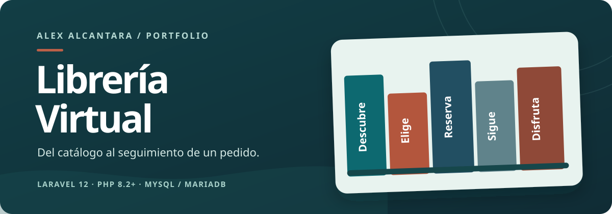
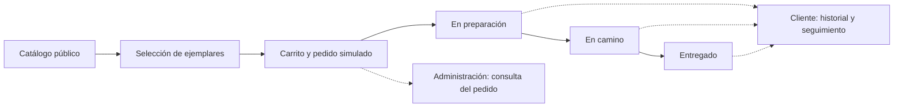

# Librería Virtual

[](https://libreria-virtual.alwaysdata.net/)

**Una biblioteca que se puede recorrer de principio a fin.** Explora libros y ejemplares, arma un pedido, sigue su entrega y descubre cómo se administra todo desde el otro lado del mostrador. Es una aplicación Laravel recuperada y preparada como demo interactiva para portfolio.

**[Abrir la demo](https://libreria-virtual.alwaysdata.net/)** · **[Elegir un rol](https://libreria-virtual.alwaysdata.net/login)** · [Ver el despliegue](docs/deploy-alwaysdata.md)

`Laravel 12` · `PHP 8.2+` · `Blade` · `MySQL / MariaDB` · `Bootstrap`

> La demo es pública y sus datos son compartidos. Usa solo información ficticia: los cambios se restablecen cada día. Los pedidos, pagos y envíos no representan transacciones reales.

## Qué puedes probar

1. **Explora el catálogo** sin iniciar sesión. Busca por título o autor y consulta los ejemplares disponibles.
2. **Entra como cliente** desde «Explorar roles». Añade un ejemplar al carrito, ajusta la cantidad y confirma un pedido simulado. También encontrarás un pedido de muestra con seguimiento listo para consultar.
3. **Cambia a envíos** para marcar un pedido «En camino», asignar una fecha estimada y registrar su entrega. Vuelve al cliente para ver el cambio en «Mis compras».
4. **Cambia a administración** para revisar pedidos, libros, ejemplares, usuarios y catálogos auxiliares. Puedes crear o editar registros ficticios.

El selector permite cambiar de rol con un clic desde cada área, sin crear una cuenta ni conocer contraseñas.

| Perspectiva | Lo que muestra |
| --- | --- |
| **Cliente** | Catálogo, carrito, confirmación, historial y seguimiento de pedidos. |
| **Cliente especializado** | Catálogo filtrado por especialidades, preferencias y el mismo flujo de compra. |
| **Envíos** | Pedidos por atender, despacho, fecha estimada y entrega simulada. |
| **Administración** | Gestión de libros, ejemplares, autores y catálogos; consulta de usuarios y pedidos. |



## Qué hay detrás

- **Inventario coherente:** el carrito reserva unidades; las reservas abandonadas caducan a los 30 minutos y se liberan en la siguiente visita relevante.
- **Seguimiento interno:** cada pedido confirmado recibe un código de demostración. El área de envíos controla las transiciones de preparación, tránsito y entrega.
- **Cuatro áreas reales:** la entrada pública usa las mismas pantallas y operaciones de cada rol. El registro de cuentas se desactiva en este modo para que los visitantes no dejen datos personales en una base compartida.
- **Datos recuperables:** una base exclusiva de demostración se vuelve a sembrar diariamente. El comando de restablecimiento comprueba el nombre exacto de la base y rechaza cuentas ajenas a las semillas previstas.
- **Interfaz sin build obligatorio:** Blade, CSS y JavaScript ya están incluidos en `public/dist`; no necesitas Node para ejecutar la aplicación.

### Tecnologías

| Capa | Implementación |
| --- | --- |
| Servidor | PHP 8.2+, Laravel 12 |
| Interfaz | Blade, Bootstrap, CSS y JavaScript propios |
| Datos | MySQL; MariaDB 11.8 en la demo publicada |
| Verificación | PHPUnit con pruebas de flujos y acceso por roles |
| Hospedaje de la demo | alwaysdata, con tarea programada de restablecimiento |

## Ejecutarlo en local

Necesitas PHP 8.2+, Composer 2 y una **base MySQL o MariaDB vacía**. El usuario de la base debe poder crear tablas, vistas, procedimientos y disparadores. Se requieren `pdo_mysql`, `mbstring`, `openssl`, `fileinfo` y las extensiones habituales de Laravel. La raíz web debe apuntar únicamente a `public/`.

1. Clona el repositorio e instala dependencias:

   ```sh
   git clone https://github.com/AlexDeRivia/libreria-virtual.git
   cd libreria-virtual
   composer install
   ```

2. Copia `.env.example` como `.env`. Configura `DB_HOST`, `DB_PORT`, `DB_DATABASE`, `DB_USERNAME` y `DB_PASSWORD` para esa base nueva. Deja `PUBLIC_DEMO_ACCESS=false` y define `DEMO_PASSWORD` con una clave privada de al menos 12 caracteres para las cuentas sembradas. Nunca subas `.env` al repositorio.

3. Inicializa y abre la aplicación:

   ```sh
   php artisan key:generate
   php artisan migrate --seed
   php artisan serve --host=127.0.0.1
   ```

4. Visita [http://127.0.0.1:8000](http://127.0.0.1:8000). En el modo local privado, inicia sesión con cualquiera de las cuentas ficticias siguientes y la clave que elegiste en `DEMO_PASSWORD`:

   | Rol | Correo |
   | --- | --- |
   | Administración | `admin@example.test` |
   | Cliente | `cliente@example.test` |
   | Cliente especializado | `especialista@example.test` |
   | Envíos | `envios@example.test` |

No ejecutes las migraciones ni las semillas sobre una base antigua o con datos que quieras conservar.

<details>
<summary><strong>Configurar una demo pública propia</strong></summary>

Usa una base **nueva y desechable**. Antes de sembrarla, configura en su `.env` privado:

```dotenv
PUBLIC_DEMO_ACCESS=true
DB_DATABASE=nombre_de_la_base_desechable
DEMO_RESET_DATABASE=nombre_de_la_base_desechable
```

En este modo, las cuentas ficticias reciben contraseñas aleatorias, aparece el acceso de un clic y se crea un pedido de muestra. `DEMO_PASSWORD` solo hace falta para sembrar en modo privado. Programa `php artisan demo:reset` para limpiar los cambios de los visitantes; **ese comando elimina y recrea las tablas de la base autorizada**. Se detiene si la base configurada no coincide o encuentra cuentas fuera de las cinco semillas previstas. El procedimiento completo está en [la guía de alwaysdata](docs/deploy-alwaysdata.md).

</details>

<details>
<summary><strong>Ejecutar las pruebas</strong></summary>

La suite de integración exige una base local separada llamada exactamente `libreria_virtual_test`, con `DB_HOST=127.0.0.1` o `localhost`. Configura en `.env` las credenciales de esa instancia y una `DEMO_PASSWORD` privada. Después, en PowerShell:

```powershell
$env:DB_HOST = "127.0.0.1"
$env:DB_DATABASE = "libreria_virtual_test"
php artisan migrate --seed --force
php artisan test
```

En Bash, usa `export DB_HOST=127.0.0.1 DB_DATABASE=libreria_virtual_test` antes de los dos comandos `php artisan`. Las pruebas usan transacciones, por eso necesitan el esquema y las semillas antes de empezar. El guard de la suite impide ejecutarlas contra otra base. Las pruebas relevantes están en [`tests/Feature`](tests/Feature).

</details>

## Estructura del proyecto

| Ruta | Contenido |
| --- | --- |
| [`app/Http/Controllers`](app/Http/Controllers) | Flujos de catálogo, clientes, envíos y administración. |
| [`app/Services`](app/Services) | Caducidad de reservas y seguimiento simulado. |
| [`database/migrations`](database/migrations) y [`database/seeders`](database/seeders) | Esquema, vistas, procedimientos y datos ficticios. |
| [`resources/views`](resources/views) y [`public/dist`](public/dist) | Pantallas y recursos de la interfaz. |
| [`tests/Feature`](tests/Feature) | Pruebas de recuperación, pedidos, envíos y acceso público. |

El criterio visual se documenta en [docs/frontend-design.md](docs/frontend-design.md). La instalación publicada y su restablecimiento diario se explican en [docs/deploy-alwaysdata.md](docs/deploy-alwaysdata.md).

## Alcance de la simulación

No hay cobros, correo transaccional ni conexión con un transportista. El código de seguimiento y los cambios de estado pertenecen solo a la aplicación. La demo pública permite modificar datos ficticios, por lo que lo que veas puede variar hasta el siguiente restablecimiento. Las cubiertas son representaciones gráficas; no se publican portadas heredadas sin permisos comprobados.

---

© 2026 Alex Alcantara · Librería Virtual. Todos los derechos reservados sobre el código y diseño originales. Los componentes de terceros conservan sus propias licencias.
